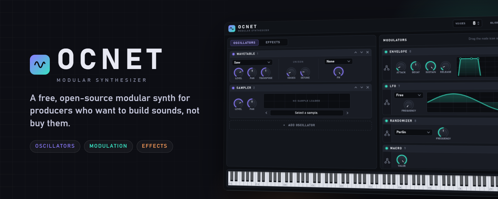

<div align="center">



<br>

**A free and open-source modular synthesizer for music producers.**<br>
Stack oscillators, wire modulators into any knob and shape the result with a chain of effects.

<br>

[](./LICENSE.md)


[**Download**](#-installation) · [Features](#-features) · [Build from source](#-building-from-source) · [Thesis](#-thesis)

</div>

---

## ✨ Overview

**Ocnet** is a digital, modular and easy-to-use synthesizer. It aims to give both beginner and experienced producers a free modular alternative to the commercial synths on the market, without giving up the essentials: every module was built with sound quality and CPU efficiency in mind.

The idea is simple: **you decide what the synth is made of.** Add as many oscillators, modulators and effects as you need, reorder them and connect any modulator to any parameter by dragging it onto a knob.

Ocnet is my final degree project in Computer Engineering at the **University of A Coruña (UDC)**.

<p align="center">
  
</p>

## 🎛 Features

<table>
<tr>
<th align="left" width="33%">🟣 Oscillators</th>
<th align="left" width="33%">🟢 Modulators</th>
<th align="left" width="33%">🟠 Effects</th>
</tr>
<tr valign="top">
<td>

**Wavetable**
- Saw, square and sine waves
- Unison with up to 8 voices and detune
- FM from any other oscillator
- Level, pan and transpose

**Sampler**
- Plays your own samples
- Level and pan

</td>
<td>

**Envelope** – ADSR with a live graph

**LFO** – free-running or tempo-synced (1/1 to 1/16)

**Randomizer** – Perlin noise or sample & hold

**Macro** – one knob that drives many parameters

</td>
<td>

**Distortion** – soft or hard clipping with drive

**Filter** – low/high pass with cutoff, resonance and mix

**EQ** – low cut, peak and high cut, 12 to 48 dB/oct

**Delay** – independent left and right times with decay

**Reverb** – delay and decay controls

</td>
</tr>
</table>

### How modulation works

Every modulator has a **node icon** on its left side. Drag it onto any knob and that parameter starts following the modulator. Each connection shows up as a small bipolar knob in the modulator's header, so you can set the amount (positive or negative) and see at a glance what is wired where. A knob that is being modulated lights up in mint.

### And also

- **Polyphony** with an adjustable number of voices, plus **glide** and **legato**.
- **Fully modular layout**: add, remove, bypass and reorder modules from their header.
- **A custom interface** drawn entirely with JUCE `LookAndFeel`, with one color per module type (violet for oscillators, mint for modulation, amber for effects) and graphs that react to your changes.

## 📦 Installation

1. Download [`Ocnet_Installer.exe`](./Installer/Ocnet_Installer.exe) from the `Installer` folder.
2. Run it. It installs:
   - the plugin to `C:\Program Files\Common Files\VST3\Ocnet.vst3`
   - the sample library to `Documents\Ocnet\Sampler`
3. Rescan plugins in your DAW and load **Ocnet** as an instrument.

> [!NOTE]
> Ocnet currently targets **Windows x64**. Any VST3 host should work (Ableton Live, FL Studio, Reaper, Bitwig, Cubase…).

## 🛠 Building from source

**Requirements**

- Windows 10/11 x64
- Visual Studio 2022 with the *Desktop development with C++* workload
- [JUCE 8](https://github.com/juce-framework/JUCE) and its Projucer

**Steps**

The Projucer project expects JUCE in a `Juce/JUCE` folder **next to** this repository:

```
your-folder/
├── Juce/JUCE/      ← JUCE 8
└── ocnet/          ← this repository
```

```bash
git clone https://github.com/JuanVillaverdeRodriguez/ocnet.git
git clone --branch 8.0.0 --depth 1 https://github.com/juce-framework/JUCE.git Juce/JUCE
```

1. Open `ocnet/ocnet/ocnet.jucer` with the Projucer and save it to regenerate the Visual Studio project.
2. Open `ocnet/ocnet/Builds/VisualStudio2022/ocnet.sln`, select **Release | x64** and build.
   Or build from the command line:

   ```bash
   msbuild ocnet.sln -p:Configuration=Release -p:Platform=x64
   ```

3. You will find the **VST3** and a **Standalone** app (handy for trying Ocnet without a DAW) under `Builds/VisualStudio2022/x64/Release/`.

## 🧩 Project structure

The code follows a **Model–View–Controller** split:

```
ocnet/Source
├── Model/        Synth engine: voices, processors and parameter handling
│   └── Synth/Processors/{Oscillators, Modulators, Effects}
├── View/         Interface: sections, module cards and LookAndFeels
├── Controller/   Glue between the interface and the engine
├── Utils/        Shared types, palette and drawing helpers
├── Tests/        Unit and stress tests (oscillators, modulations, parameters…)
└── Libraries/    Third-party DSP (Signalsmith)
```

## 📚 Thesis

The full write-up of the project (design, architecture, DSP and evaluation) is available in Spanish:

- [Memoria (final report)](./Memoria/Memoria.pdf)
- [Anteproyecto (project proposal)](./Memoria/Anteproyecto.pdf)

## 🙏 Acknowledgements

- [JUCE](https://juce.com/), the framework behind the audio engine, plugin formats and interface.
- [Signalsmith DSP](https://signalsmith-audio.co.uk/code/dsp/), used for the reverb ([MIT license](./ocnet/Source/Libraries/SignalSmithLibrary/dsp/LICENSE.txt)).

## 📄 License

Ocnet is licensed under the **GNU Affero General Public License v3.0 (AGPLv3)**. See [LICENSE](./LICENSE.md) for details.

<div align="center">
<br>
Made by <a href="https://github.com/JuanVillaverdeRodriguez">Juan Villaverde</a> · <a href="https://juanvr.dev">juanvr.dev</a>
</div>
